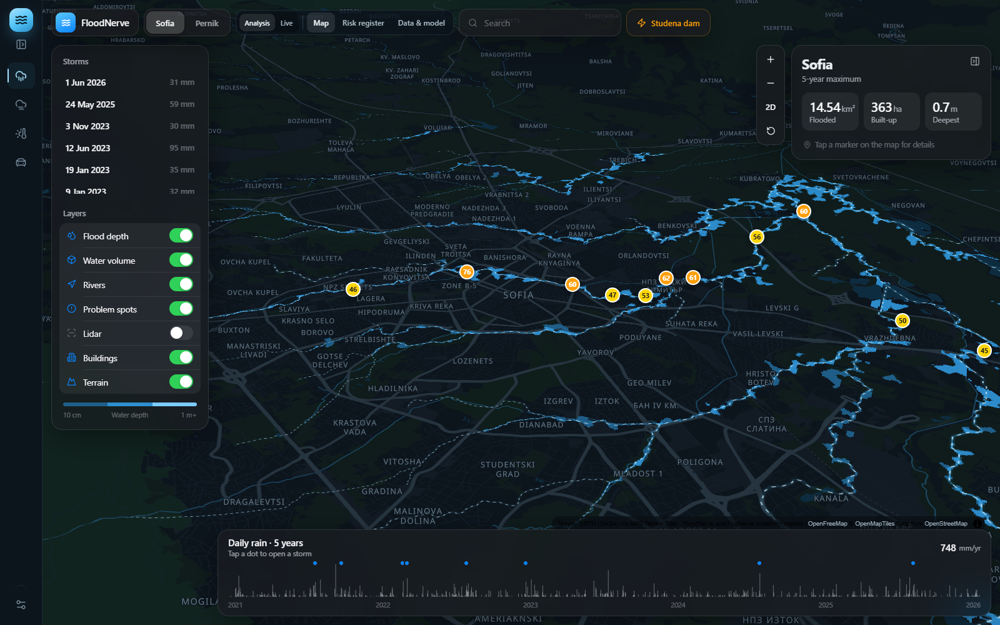
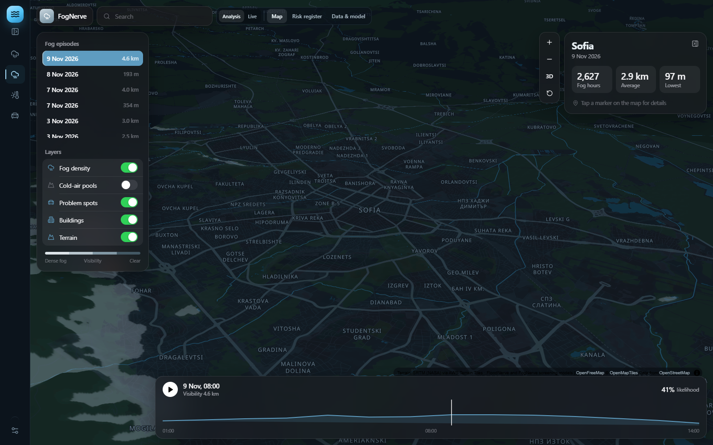
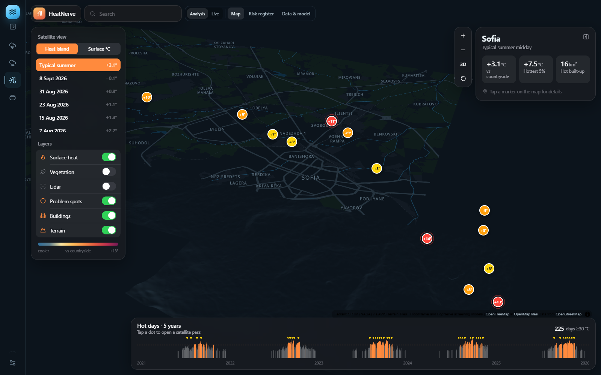
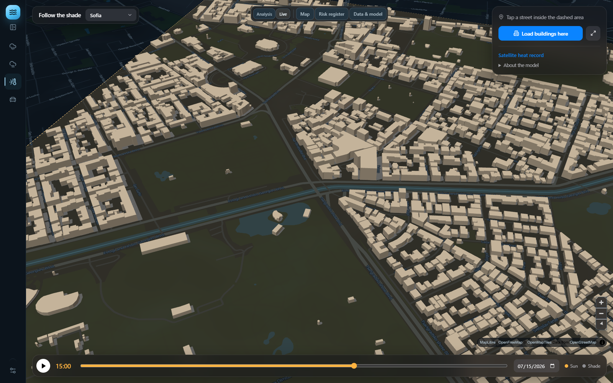
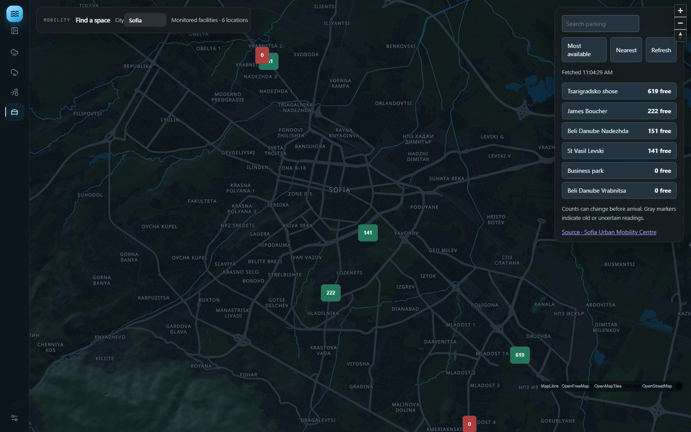

<div align="center">

# CityNerve

### One city. Four ways to understand it.

**See flood risk. Understand fog. Find urban heat. Check available parking.**

A visual city dashboard that brings Earth observation, weather records, building geometry, and parking feeds onto interactive maps.

[Explore the app](#explore-the-app) · [Run locally](#run-locally) · [Data and accuracy](#data-and-accuracy) · [For developers](#for-developers)

</div>



## The idea

Cities have plenty of data. Understanding what it means for a particular street or neighborhood is harder.

CityNerve puts that information on the map. Instead of reading separate weather tables, satellite records, and parking websites, you can explore a city, inspect a place, and see the evidence behind it.

- **Where could water collect during a storm?** Explore modeled flood depths and problem spots.
- **Which areas are prone to fog?** Compare recorded airport fog events with a terrain-based screening layer.
- **Why do some neighborhoods get hotter?** Inspect satellite-measured surface heat and explore building shadows through the day.
- **Where can I park?** Check operator-reported availability at supported facilities.

It is built for curious residents, students, researchers, and city teams exploring where to investigate next.

## Explore the app

| Module | What you can explore | What powers it |
| --- | --- | --- |
| **FloodNerve** | 3D terrain, storm playback, modeled flood depths, hotspots, and a risk register | Terrain, rainfall, soil wetness, land cover, and space lidar |
| **FogNerve** | Recorded fog episodes, playback, terrain-proneness maps, and risk summaries | Airport observations, weather reanalysis, terrain, and land cover |
| **HeatNerve** | Summer surface heat, named hotspots, possible cooling actions, and building shadows | Landsat thermal imagery, vegetation and albedo, lidar, and building geometry |
| **Mobility** | Parking maps, facility search, available-space sorting, and provider freshness | Public parking-provider feeds |

### Flood - follow the storm

Choose a study area and recorded storm, explore the map, and play through its modeled development. Open the risk register to inspect problem spots, or Data & model to see how the results were produced.

Flood study areas are configured for **Sofia and Pernik**. Coverage follows the generated datasets, rather than every city on the basemap.

### Fog - make low visibility visible



Explore observed fog episodes at Sofia Airport alongside modeled terrain-proneness layers. The event catalogue and data pages help distinguish measured observations from model outputs.

### Heat - see where the city holds heat



Heat analysis shows places where roofs, roads, and paved ground are hotter than the surrounding vegetated countryside. Inspect hotspots to understand the contributing surfaces and suggested cooling measures.

**Want to explore shade at street level?** Switch to the Heat Live view, choose a town, and change the time of day. Building shadows move with the calculated sun position. Load buildings around the area you want to inspect.



Satellite heat analysis and the building-shadow explorer have different coverage. Selecting another town for shadows does not create a new Landsat heat dataset for that town.

### Mobility - find a space, not another spreadsheet



Choose **Sofia, Basel, Ghent, St. Gallen, or Zürich**, search facilities, and compare reported availability. Coverage is limited to participating facilities; it is not a count of every street parking space in a city.

Parking responses are cached for 60 seconds. Failed refreshes retain the last successful readings with a stale indicator. Provider update times and available fields vary.

### Inspect this place

On the Flood, Fog, satellite Heat, or Heat Live map, enable **Inspect place** and click a street or building. The shared panel shows modeled flood depth, satellite surface heat, building shade, and fog terrain context where their datasets cover that point.

- Switch between maps of the same city to keep the selected location and dataset context.
- Adjust the date and local time to explore shade. This does not change historical flood or satellite observations.
- Expand each card for its source, date, resolution, and limitations. Missing coverage stays unavailable.
- Copy a location link to reopen the point, or press Escape to close inspection.

Sofia has overlapping datasets. Other towns expose only the layers available for them. Building-footprint selections are identified separately from outdoor shade. Inspection runs locally without AI calls.

## Run locally

Requires **Node.js 20.19+ or 22+**, npm, and internet access for map tiles and external feeds.

```bash
npm install
npm run dev
```

Open the URL printed in the terminal, usually **http://localhost:5173**.

Start with **Flood**, then explore **Fog**, **Heat**, and **Mobility** from the navigation rail. Flood, Fog, and Heat provide Analysis and Live view controls where configured. Some Live views are still framework placeholders; Heat includes the interactive shadow explorer.

### Production

```bash
npm run build
npm start
```

Open **http://localhost:3000**. Set `PORT` to use another port.

Use the Node server for deployment: it serves both the built app and the parking API. A static-file-only host needs the parking backend connected separately. `npm run preview` is available for checking a production build locally.

### Generate the environmental datasets

The app reads generated analysis files from `public/data/`. Rendering the app and generating those datasets are separate steps. Missing outputs must be generated before their analysis views can show results.

Create a Python environment and install the pipeline dependencies:

```bash
python -m venv pipeline/.venv
```

On Windows:

```bash
pipeline/.venv/Scripts/python -m pip install -r pipeline/requirements.txt
```

On macOS or Linux:

```bash
pipeline/.venv/bin/python -m pip install -r pipeline/requirements.txt
```

Then run the datasets you need:

| Command | Purpose |
| --- | --- |
| `npm run data` | Generate the flood and fog analysis datasets |
| `npm run data:fog` | Generate fog inputs and model outputs |
| `npm run data:heat` | Generate heat inputs and model outputs |

Downloads and processing can take time. See the [pipeline guide](pipeline/README.md) for inputs, methods, and configuration.

## Data and accuracy

**Real inputs. Transparent models. Clear limits.**

| Area | Main inputs | How to interpret the result |
| --- | --- | --- |
| Flood | NASA/NGA SRTM terrain, ICESat-2 lidar, GPM IMERG rainfall, MERRA-2 weather and soil wetness, ESA WorldCover | Flood depths are screening-model estimates. Sewer capacity is assumed and the terrain grid is about 28 m. Curbs and narrow underpasses are not resolved. |
| Fog | Iowa Environmental Mesonet METAR observations at Sofia Airport, ERA5 via Open-Meteo, NASA POWER weather, terrain and land cover | Airport events are observations. The city-wide terrain layer is modeled proneness, not measured visibility on every street. |
| Heat | Landsat 8/9 surface temperature and reflectance via Microsoft Planetary Computer, GEDI and ICESat-2 lidar via SlideRule, NASA POWER weather | Landsat measures surface temperature near its daytime overpass, not the air temperature felt by a pedestrian. Cooling estimates are statistical associations. |
| Shadows | Building footprints and heights, SunCalc solar position | Shadows depend on the completeness of building geometry and height data. They do not measure local air temperature. |
| Parking | Supported public operator feeds | Availability reflects the provider's last report. Capacity, timestamps, and coverage vary by city. |

Maps use **MapLibre GL**, **OpenFreeMap/OpenStreetMap**, and terrain layers where enabled. Attribution stays visible in the app.

CityNerve is an exploration and screening prototype. It is not an official warning system, an engineering flood assessment, or a substitute for local observations.

<details>
<summary><strong>Parking sources and reuse notes</strong></summary>

- **Sofia:** operator-reported availability for six facilities. Capacity and measurement timestamps are not supplied; confirm operator reuse terms before public deployment.
- **Basel:** Basel-Stadt parking data, CC BY 4.0. Impossible counts are excluded.
- **Ghent:** municipal parking data under its free-reuse model license.
- **St. Gallen:** CC BY-NC data. Noncommercial reuse restrictions apply.
- **Zürich:** official PLS RSS under CC0, joined to ParkenDD facility metadata. Facilities without usable coordinates or counts are excluded.

Public data availability does not mean every provider has identical reuse terms. Check the source terms for your deployment.

</details>

## For developers

```text
src/                 React pages, maps, visualizations, and interactions
shared/              Shared city and provider configuration
server/              Parking adapters, caching, and production HTTP server
pipeline/            Environmental data downloads and screening models
public/data/         Generated datasets consumed by the app
tests/               Heat geometry and parking adapter checks
docs/screenshots/    Real app captures used in this README
```

The frontend uses **React 18**, **Vite 6**, **MapLibre GL**, and **Lucide**. Python pipelines prepare environmental datasets; the Node backend provides `/api/parking/{city}` in development and production.

Run the existing checks:

```bash
node --test tests/*.test.js
npm run build
```

### Adding another city

A map can pan anywhere, but analysis coverage needs city-specific data.

- **Flood:** add a study area in `src/data.js`, configure the pipeline, generate its outputs, and validate the model assumptions locally.
- **Fog and satellite heat:** generate and validate the relevant observation and imagery datasets before exposing a new analysis area.
- **Building shadows:** add a town configuration and building geometry supported by the existing heat explorer.
- **Parking:** add a city in `shared/parkingCities.js` and a provider adapter with verified coordinates, availability fields, attribution, and reuse terms.

Keep provider failures visible, preserve source timestamps, and label modeled or approximate information clearly.

---

<div align="center">

**CityNerve - turn city data into places people can understand.**

</div>

### Parking inventory and board demonstrations

**Live parking** uses operator availability feeds for supported cities. **Parking inventory** loads OpenStreetMap locations within 3.5 km of the selected city; its optional occupancy and closure controls are explicitly simulated and drive the smart-board previews. OSM does not supply live occupancy.

The inventory uses `/api/osm-parking` through the same Node middleware in `npm run dev`, `npm run preview`, and `npm start` (after `npm run build`). Restart Vite after changing server code. Static-only hosting needs this API service as well. Server requests identify CityNerve, allow up to 25 seconds per Overpass provider, and fail over across three public providers. Successful location inventories are cached for 24 hours in `.cache/osm-parking`; provider failures can reuse inventories up to seven days old, explicitly marked as older cached locations. Cached timestamps are preserved. A first request can take up to 75 seconds when providers are busy; an outage with no cache shows an error rather than invented locations.
